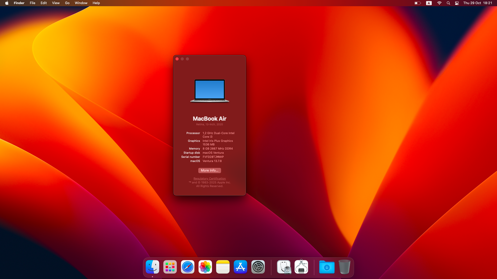

# macOS 13 Ventura on Acer Aspire A315-56

OpenCore configuration for running macOS 13 Ventura on Acer Aspire A315-56 laptop.

## Hardware Specifications

- **CPU:** Intel Core i3-1005G1
- **GPU:** Intel UHD Graphics (Ice Lake)
- **Display:** AUOE997 (1920x1080)
- **Storage:** ARDOR GAMING m.2 NVMe 512Gb AL1284
- **Wi-Fi:** Intel Wireless-AC 9462
- **Bluetooth:** Intel Wireless Bluetooth
- **Ethernet:** Realtek PCIe GbE Family Controller
- **Audio:** Realtek Audio (Codec ALC255)
- **Touchpad:** ELAN0521

### What's Working

- **Audio:** Speakers, headphones, and microphone (powered by AppleALC)
- **Wi-Fi:** Native connection via AirportItlwm
- **Bluetooth:** Fully functional
- **Web Camera:** Working out of the box
- **Battery:** Percentage readout and status monitoring
- **Power Management:** System sleep and wake functions
- **Input:** Keyboard and Touchpad mapping

### What's Not Working

- **HDMI:** Video output does not work. Ice Lake integrated GPUs do not natively support HDMI output on this platform, only DisplayPort (DP).

## Important Notes

- **USB Ports:** You must map your own USB ports and use your custom UTBMap.kext.
- **Wireless:** Wi-Fi works immediately after installation. Running OCLP is not required for wireless card features.
- **SMBIOS:** Use MacBookAir9,1